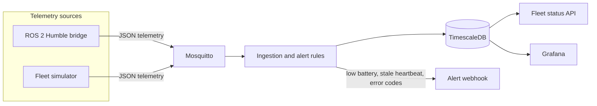

# Robot fleet telemetry

[](https://github.com/applycoding/robot-fleet-mqtt-telemetry/actions/workflows/ci.yml)

A small fleet pipeline: robots publish pose, battery, status, and error codes as JSON. Mosquitto carries the messages, an ingestion service writes them to TimescaleDB, threshold rules call a webhook, and a REST API plus a Grafana dashboard read the same tables.

The default path is a ROS-free simulator, so the demo and CI run without a robot. A ROS 2 Humble node publishes the same JSON when a ROS graph is available.

## Demo note

This is a portfolio demo of that path, built to be read and run locally. It is sized for a laptop, not for a factory network.

`docker compose up` starts the simulator, not ROS and not a physical robot. The simulator emits the same payload the Humble bridge emits. The bridge itself is a real `rclpy` node; bring it in with the `ros` compose profile, or run it from a sourced Humble workspace. The optional CI job builds that node inside `ros:humble-ros-base`.

The demo broker allows anonymous MQTT clients. The API does not authenticate callers. The database password is `fleet` and is checked in so one command boots the stack. Grafana signs in anonymously as an admin on localhost, and the form login is `admin` / `admin`.

Alerting is three edge-triggered rules with a cooldown: low battery (suppressed while the robot reports charging), a missed heartbeat, and an error code the robot was not already reporting. Rules notify when a condition starts. They notify again after it clears and comes back.

## Architecture



## Run the demo

Docker Compose v2 is enough.

```bash
docker compose up --build
```

| Surface | URL |
| --- | --- |
| Fleet API | http://localhost:8000/fleet |
| OpenAPI | http://localhost:8000/docs |
| Grafana | http://localhost:3000 |
| Webhook log | `docker compose logs -f webhook` |
| MQTT | `localhost:1883` |
| Postgres | `localhost:5432` (`fleet` / `fleet`, database `fleet`) |

```bash
curl -s localhost:8000/health
curl -s localhost:8000/fleet
curl -s localhost:8000/alerts
```

The simulator publishes four robots once a second:

| Robot | Behavior |
| --- | --- |
| `amr-01` | Patrols with a healthy battery |
| `amr-02` | Starts at 18% and drains through the critical threshold |
| `amr-03` | Reports `E_LIDAR_TIMEOUT` |
| `amr-04` | Publishes twice, then goes silent so the heartbeat rule fires |

`docker compose down -v` drops the Timescale volume.

To add the Humble bridge beside the simulator (the image is large):

```bash
docker compose --profile ros up --build
```

That container runs `fleet_mqtt_bridge` with `demo_motion:=true`, so it publishes `amr-ros` without a robot. Point a real graph at the broker by running the node from a sourced workspace and leaving `demo_motion` false:

```bash
source /opt/ros/humble/setup.bash
colcon build --paths ros2_bridge
source install/setup.bash
ros2 launch ros2_bridge bridge.launch.py
```

Parameters: `robot_id`, `mqtt_host`, `mqtt_port`, `mqtt_topic_prefix`, `pose_topic`, `battery_topic`, `status_topic`, `diagnostics_topic`, `publish_period_sec`, `demo_motion`.

Topics are `geometry_msgs/PoseStamped`, `sensor_msgs/BatteryState`, `std_msgs/String`, and `diagnostic_msgs/DiagnosticArray`. `BatteryState.percentage` is read as a 0–1 fraction, which is the ROS convention. A value above 1 is kept as a percent for drivers that already publish 0–100.

## Wire format

Topic: `fleet/telemetry/<robot_id>`

```json
{
  "robot_id": "amr-01",
  "time": "2026-10-17T00:00:00Z",
  "pose": {"x": 1.2, "y": 0.4, "yaw": 0.3, "frame_id": "map"},
  "battery": {"percent": 82.0, "voltage": 25.9, "charging": false},
  "status": "navigating",
  "errors": [
    {"code": "E_LIDAR_TIMEOUT", "message": "front lidar scan is stale", "severity": "warning"}
  ]
}
```

`time` is timezone-aware ISO-8601. `battery.percent` is 0–100. Error `severity` is `warning` or `critical`.

## Alert rules

| Rule | Fires when | Severity |
| --- | --- | --- |
| `low_battery` | Percent is at or below 20, and the robot is not charging | `warning`, or `critical` at or below 10 |
| `stale_heartbeat` | No sample for 15 seconds after the robot has been seen | `warning` |
| `error_code` | An error code appears that was not on the previous sample | The error's own severity |

The webhook body is the alert JSON (`robot_id`, `alert_type`, `severity`, `message`, `time`, `details`). A failed POST is logged and the alert row is still stored. Thresholds are environment variables on the ingestion service; see `docker-compose.yml`.

## API

| Method | Path | Purpose |
| --- | --- | --- |
| `GET` | `/health` | Database ping. `503` when Postgres is unreachable |
| `GET` | `/fleet` | Latest sample per robot, with `online` |
| `GET` | `/fleet/{robot_id}` | Latest sample for one robot |
| `GET` | `/fleet/{robot_id}/history?minutes=15` | Samples in the window |
| `GET` | `/alerts?limit=50&robot_id=` | Newest alerts |

`online` means the latest sample is within `STALE_AFTER_SECONDS` (15 by default), the same window the heartbeat rule uses.

## Tests and CI

Unit tests cover payload parsing, the alert rules, ingestion with a fake store and a fake webhook, the simulator's four stories, and the API response mapping. They do not need Docker.

The integration job uses GitHub Actions service containers: TimescaleDB, and Mosquitto started with `/mosquitto-no-auth.conf` so the runner can reach port 1883. The test publishes telemetry, waits for rows, and checks that low battery, error codes, and a stale heartbeat hit both the database and a local webhook.

The ROS job is separate and optional (`continue-on-error`). It runs `script/ros-ci.sh` inside `ros:humble-ros-base`, builds the `ament_python` package, and pytest-checks the message codec and the node without a broker.

```bash
pip install -e ".[dev]"
ruff check .
pytest -q -m "not integration"
```

## Layout

```
src/fleet_telemetry/    schema, rules, Timescale store, ingest, simulator, API
ros2_bridge/            Humble rclpy node
grafana/                datasource provisioning and the fleet dashboard
mosquitto/              anonymous listener for the compose network
script/ros-ci.sh        commands the optional ROS job runs
```

## License

Apache-2.0. Copyright 2026 Arpan Bom.
